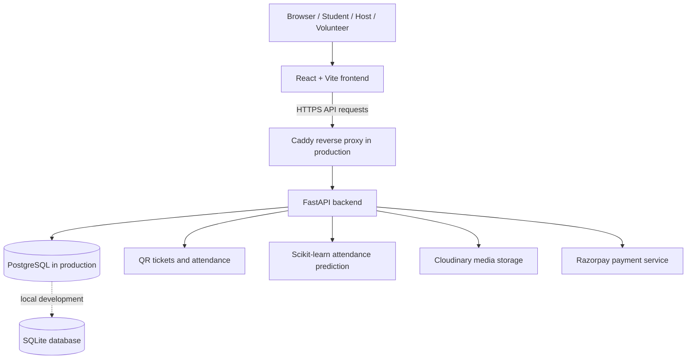

# CollegeBuddy — CampusIQ Event Management Platform

[](https://react.dev/)
[](https://fastapi.tiangolo.com/)
[](https://www.postgresql.org/)
[](https://www.docker.com/)

CollegeBuddy (also referred to as CampusIQ in parts of the codebase) is a full-stack campus event management application. It helps students discover and register for events, hosts publish and manage events, and authorized volunteers verify attendee tickets with QR codes. The platform also includes event analytics, an attendance-prediction model, volunteer workflows, and optional online payments.

**Live frontend:** [campus-iq-rho.vercel.app](https://campus-iq-rho.vercel.app)  
**Repository:** [harshit-033/College_Buddy](https://github.com/harshit-033/College_Buddy)

> The repository contains deployment configuration for multiple hosting options. Production URLs, credentials, database access, image storage, and payment processing must be configured for your own deployment. Features that require third-party credentials will not work until those services are configured.

## Contents

- [Problem](#problem)
- [Solution and Features](#solution-and-features)
- [User Roles](#user-roles)
- [Technology Stack](#technology-stack)
- [Architecture](#architecture)
- [Project Structure](#project-structure)
- [Run Locally](#run-locally)
- [Environment Variables](#environment-variables)
- [Docker Setup](#docker-setup)
- [Deployment Options](#deployment-options)
- [Health Checks and CI](#health-checks-and-ci)
- [Security and Production Notes](#security-and-production-notes)
- [Limitations and Future Improvements](#limitations-and-future-improvements)
- [Contributing](#contributing)

## Problem

Campus events are often coordinated across separate forms, spreadsheets, chat groups, and manual attendance lists. This can make event discovery inconsistent, registration tracking difficult, entry verification slow, and post-event reporting time-consuming. Paid events introduce additional concerns around payment reconciliation and receipts.

## Solution and Features

CollegeBuddy brings common event workflows into one web application:

- **Event discovery:** browse and search published campus events, with event details such as venue, schedule, fees, capacity, and event category.
- **Role-based experiences:** separate student and host workflows, with protected frontend routes and backend authorization checks.
- **Event publishing and management:** hosts can create and update events, configure participant capacity and fees, manage event posters, and oversee registrations.
- **Registration and QR tickets:** eligible attendees can register for events and receive a unique QR ticket.
- **QR-based attendance:** an in-browser scanner supports ticket verification and check-in. The backend also tracks attendance to reduce duplicate check-ins.
- **Volunteer workflows:** hosts can manage event-specific volunteer eligibility and approvals; students can apply to volunteer.
- **Host analytics:** view event registrations, check-in totals, and payment-related revenue summaries.
- **Attendance prediction:** a saved scikit-learn model is loaded from `backend/ai/attendance_model.pkl` when available. Prediction quality depends on the model and training data; it should not be treated as a guaranteed forecast.
- **Payments and receipts:** Razorpay integration supports the payment flow, while successful transactions can have downloadable PDF receipts. Configure Razorpay credentials and test the complete flow in Razorpay test mode before enabling live payments.
- **Image and QR storage:** Cloudinary can be used for persistent hosted media. Local filesystem storage is a development fallback and is not appropriate for durable data on many ephemeral hosting platforms.

## User Roles

| Role | Main capabilities |
| --- | --- |
| **Student** | Discover events, view details, register, access QR tickets, manage profile, and apply for volunteer opportunities. |
| **Host** | Create and manage events, review registrations and volunteers, and view analytics. |
| **Volunteer** | Access authorized event check-in workflows and scan tickets. Volunteer access is managed through event-related permissions. |

Public registration in the current backend accepts **student** and **host** roles; do not assume a user can self-register directly as a volunteer.

## Technology Stack

| Layer | Technologies |
| --- | --- |
| Frontend | React 19, Vite, React Router, Tailwind CSS, Axios, Lucide React, React Hot Toast |
| QR scanning | `html5-qrcode` |
| Backend API | Python 3.11, FastAPI, Uvicorn, Gunicorn |
| Data access | SQLAlchemy |
| Database | SQLite for local development; PostgreSQL for production |
| Database migrations | Alembic |
| Authentication | JWT access tokens, password hashing with Passlib/Bcrypt, role-based authorization |
| QR and PDFs | `qrcode`, Pillow, ReportLab |
| Attendance model | scikit-learn, joblib, NumPy, pandas |
| Media | Cloudinary (optional for development; required by the configured production mode) |
| Payments | Razorpay |
| Deployment | Docker Compose, Caddy reverse proxy, and configuration files for Vercel and Render |

## Architecture



The frontend is a static single-page application. The backend exposes REST endpoints and performs business logic, authentication, database operations, QR generation/check-in, and integrations. In the production Docker Compose configuration, PostgreSQL is placed on an internal Docker network and Caddy serves as the public HTTPS reverse proxy.

## Project Structure

```text
College_Buddy/
├── backend/
│   ├── main.py                 # FastAPI routes and application logic
│   ├── models.py               # SQLAlchemy data models
│   ├── database.py             # Database engine/session configuration
│   ├── auth.py                 # Current-user authentication dependency
│   ├── security.py              # Password hashing and JWT helpers
│   ├── requirements.txt        # Python dependencies
│   ├── Dockerfile
│   ├── alembic/                # Database migrations
│   └── ai/
│       ├── attendance_model.pkl
│       └── train_model.py
├── frontend/
│   ├── src/
│   │   ├── api/                # API client
│   │   ├── components/         # Shared UI and protected routes
│   │   └── pages/              # Auth, events, tickets, host, scanner, etc.
│   ├── public/_redirects       # SPA fallback for compatible static hosts
│   ├── package.json
│   └── Dockerfile
├── docs/deployment/            # Hosting configuration examples
├── scripts/smoke_test.sh       # API health smoke test
├── docker-compose.yml          # Local full-stack setup
├── docker-compose.prod.yml     # Production-style API + PostgreSQL + Caddy
├── Caddyfile
└── README.md
```

## Run Locally

### Prerequisites

- Python 3.11
- Node.js 22 (or a compatible current Node.js release)
- npm
- Git

PostgreSQL is not required for the basic local development flow; the backend defaults to a local SQLite database when `DATABASE_URL` is not set.

### 1. Clone the repository

```bash
git clone https://github.com/harshit-033/College_Buddy.git
cd College_Buddy
```

### 2. Start the backend

Linux/macOS:

```bash
cd backend
python3.11 -m venv .venv
source .venv/bin/activate
python -m pip install --upgrade pip
pip install -r requirements.txt
uvicorn main:app --reload --host 0.0.0.0 --port 8000
```

Windows PowerShell activation command:

```powershell
cd backend
py -3.11 -m venv .venv
.\.venv\Scripts\Activate.ps1
python -m pip install --upgrade pip
pip install -r requirements.txt
uvicorn main:app --reload --host 0.0.0.0 --port 8000
```

The local API is available at `http://localhost:8000`; interactive API docs are at `http://localhost:8000/docs`. The root endpoint should return a message indicating that the backend is running. The health endpoint is `http://localhost:8000/health`.

### 3. Start the frontend

In a second terminal from the repository root:

```bash
cd frontend
npm ci
npm run dev
```

Vite normally serves the frontend at `http://localhost:5173`. During local development the API client falls back to the current machine hostname on port 8000. To override it, create `frontend/.env` with:

```dotenv
VITE_API_URL=http://localhost:8000
```

Restart the Vite development server after changing environment variables.

### 4. Validate the backend

With the API running:

```bash
./scripts/smoke_test.sh http://localhost:8000
```

On Windows, use a Bash-compatible shell (such as Git Bash) for this script, or test `/` and `/health` in a browser or with curl.

## Environment Variables

Never commit real credentials. The root `.env.example`, `backend/.env.example`, and `frontend/.env.example` provide templates; inspect them and configure the variables for the deployment method you choose.

| Variable | Used by | Purpose |
| --- | --- | --- |
| `ENVIRONMENT` | Backend | Set to `development` locally and `production` for production deployments. |
| `DATABASE_URL` | Backend | SQLite URL locally or PostgreSQL URL in production. |
| `SECRET_KEY` | Backend | JWT signing secret. Generate a unique strong value with `openssl rand -hex 32`. |
| `FRONTEND_URL` | Backend | Allowed frontend origin(s) for production CORS. Use the full origin, without a path. Multiple comma-separated origins are supported by the backend. |
| `CLOUDINARY_URL` | Backend | Cloudinary media/QR persistence. The current production configuration requires this value. |
| `RAZORPAY_KEY_ID` | Backend | Razorpay API key ID. |
| `RAZORPAY_KEY_SECRET` | Backend | Razorpay API secret. Keep secret-side operations on the backend. |
| `POSTGRES_DB` | Production Compose | PostgreSQL database name. |
| `POSTGRES_USER` | Production Compose | PostgreSQL user. |
| `POSTGRES_PASSWORD` | Production Compose | Strong PostgreSQL password. |
| `DOMAIN` | Caddy / production Compose | Public API domain, such as `api.example.com`, whose DNS points to the server. |
| `VITE_API_URL` | Frontend build | Public base URL for the backend API, such as `https://api.example.com`. |

**Important:** Vite variables prefixed with `VITE_` are embedded into the browser bundle and are public. Never put database passwords, JWT secrets, Cloudinary API secrets, or Razorpay secret keys in frontend variables.

Generate a JWT secret locally:

```bash
openssl rand -hex 32
```

Use Razorpay test keys while validating payment flows. Switch to live keys only after testing server-side order creation, signature verification, success/failure handling, and webhook requirements.

## Docker Setup

### Local development stack

The root `docker-compose.yml` starts PostgreSQL, the backend, and the frontend:

```bash
cp .env.example .env
# Edit .env and set a strong SECRET_KEY and any optional integration values.
docker compose up --build
```

Then open:

- Frontend: `http://localhost:5173`
- Backend: `http://localhost:8000`
- API docs: `http://localhost:8000/docs`

The local Compose file is for development only; it uses development database credentials and exposes service ports. Do not use those defaults on a public server.

### Production-style Docker stack

The repository includes `docker-compose.prod.yml`, which runs PostgreSQL, the FastAPI backend, and Caddy. It expects the root `.env` file to contain production configuration. Before starting it:

1. Set unique, strong credentials and the real `DOMAIN`, `FRONTEND_URL`, and database URL.
2. Ensure the domain's DNS record points to the server.
3. Verify the EC2 security group allows inbound ports 80 and 443; restrict SSH (22) to your own IP.
4. Keep PostgreSQL (5432) and FastAPI (8000) private; the production Compose file is designed for internal access to these services.
5. Run the database migrations before serving production traffic.

From the repository root:

```bash
docker compose -f docker-compose.prod.yml up -d postgres
docker compose -f docker-compose.prod.yml run --rm backend alembic upgrade head
docker compose -f docker-compose.prod.yml up -d --build
docker compose -f docker-compose.prod.yml ps
```

Check logs with:

```bash
docker compose -f docker-compose.prod.yml logs -f backend
docker compose -f docker-compose.prod.yml logs -f caddy
```

Use `docker compose -f docker-compose.prod.yml down` to stop the stack. Do **not** add `-v` unless you intentionally want to delete the named database volume.

## Deployment Options

### Option A — AWS EC2 (single-server, low-traffic demo)

The app can be hosted on a single EC2 instance using the included production Docker Compose configuration. This is the most direct way to run the entire stack on AWS, but an instance with very little RAM may struggle because PostgreSQL, Python dependencies (including NumPy/SciPy/scikit-learn), the API, and Docker run together.

Recommended starting point for a constrained demo: choose an eligible small EC2 instance only after checking your account's current Free Tier/credit eligibility and the available RAM. Build the frontend on your local machine or a CI runner if the server runs out of memory during image builds. Store persistent data in a backed-up volume and test a restore procedure.

**AWS cost caveat:** “Free Tier” is not universally 12 months of free EC2 anymore. New AWS accounts are generally on a credit-based offer; eligibility depends on account age, selected account plan, services, and usage. Public IPv4, disks, data transfer, snapshots, and other resources may incur costs. Configure AWS Budgets and billing alerts before deployment. See [AWS Free Tier](https://aws.amazon.com/free/) and [EC2 Free Tier usage limits](https://docs.aws.amazon.com/AWSEC2/latest/UserGuide/ec2-free-tier-usage.html).

### Option B — Vercel (frontend) + separate API host

The frontend is a Vite static application and the repository already has a Vercel SPA rewrite configuration. Deploy the `frontend` directory as the Vercel project root and set `VITE_API_URL` to the public API base URL. The FastAPI backend must still be hosted elsewhere and configured with the correct `FRONTEND_URL`, database, and provider credentials.

### Option C — Render configuration

A Render blueprint is provided at `docs/deployment/render.yaml` for a static frontend and Python backend. Review the blueprint and its database/storage choices before using it. Free web services may sleep, have resource limits, and are not a substitute for persistent production infrastructure; ensure database and uploaded media persistence are handled separately.

### Option D — Cloudflare Pages frontend + API elsewhere

The Vite frontend can also be deployed to Cloudflare Pages with `frontend` as the root directory, `npm run build` as the build command, and `dist` as the output directory. Set `VITE_API_URL` to the publicly reachable backend URL. Cloudflare Pages hosts the static frontend; it does not automatically host this FastAPI/PostgreSQL backend.

## Health Checks and CI

- `GET /` — basic API response.
- `GET /health` — checks that the API can execute a simple database query.
- Interactive API docs: `/docs` (consider disabling or protecting them for production if appropriate).
- `.github/workflows/ci.yml` — GitHub Actions workflow for backend import/migration checks and frontend lint/build checks.
- `scripts/smoke_test.sh` — checks the root and health endpoints against a target API URL.

## Security and Production Notes

Before using this for real users:

- Use unique production secrets and rotate any credential that has ever been committed to a public repository.
- Verify that every protected API endpoint checks ownership and role permissions on the server; frontend route guards are not a security boundary.
- Keep database and backend ports private, enable HTTPS, and restrict SSH to trusted IP addresses.
- Use PostgreSQL in production, apply Alembic migrations, configure automated backups, and test restoration.
- Persist media outside the instance or use Cloudinary/S3-compatible object storage; do not rely on ephemeral container storage for user uploads or QR image files.
- Configure and test CORS with the exact frontend origin(s).
- Validate Razorpay payment creation and verification in test mode before using live transactions.
- Set up AWS Budgets, billing alerts, and usage monitoring before launching cloud resources.
- Keep dependencies patched and review CI results before deploying.

## Limitations and Future Improvements

The repository is a working project, not evidence of a load-tested production service. Before a public launch, prioritize:

- Automated backend unit/integration tests for authentication, access control, QR check-in, payment verification, and duplicate registration.
- Rate limiting, stricter upload limits and content validation, secure token lifecycle/refresh, and production error/log monitoring.
- Better observability for payment failures and external service outages.
- Documented model training data, evaluation metrics, and prediction limitations for the attendance model.
- Database backup automation and restore drills.
- A clear license file and screenshots/demo video, if the project is intended for public reuse.

## Contributing

Contributions are welcome.

1. Fork the repository.
2. Create a branch: `git checkout -b feature/your-feature`.
3. Make and test your changes.
4. Commit: `git commit -m "Describe your change"`.
5. Push your branch and open a pull request.

---

**Maintainer:** [harshit-033](https://github.com/harshit-033)  
**Project:** [College_Buddy](https://github.com/harshit-033/College_Buddy)
